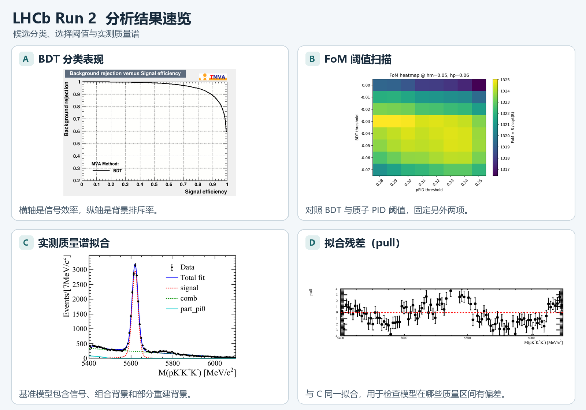

# LHCb Run 2 候选筛选与质量谱分析

高焕智 · 北京大学物理学院 · Λb → pKKK 衰变道

## 结果速览

点击速览图可打开[完整图册（8 页 PDF）](figures.pdf)。

我在课题组既有分析框架下，复现了 2015—2018 年样本的候选筛选流程，核对逐步通过率，并整理了 BDT 分类诊断、粒子鉴别（PID）阈值扫描和实测质量谱拟合结果。

## 项目做了什么

1. **候选筛选。** 在实验组服务器运行触发预选、背景质量变量计算、背景排除及轨迹接受度筛选，记录各步保留的候选数。模拟样本额外做真值匹配。
2. **BDT 与阈值扫描。** 以模拟信号与实测高质量侧带背景训练分类器。结合训练与测试分布、ROC 及 BDT/PID 热力图，检查信号保留与背景排斥的取舍。
3. **质量谱拟合。** 比较粒子和反粒子候选的联合拟合。用按误差归一化的残差（pull）定位高质量侧的连续偏差，再与加入额外背景分量的拟合对照。

## 查看与下载

- [分析流程与源码索引](docs/workflow.md) · [图件索引](docs/figures.md)
- [查看 8 张图件（PDF）](figures.pdf)：训练诊断、ROC、阈值热力图、质量谱和 pull。
- [下载完整展示材料（ZIP）](project-files.zip)：14 份源码、8 张原图和 3 份说明，保留原目录结构。源码位于解压后的 `code/`，流程和图件索引位于 `docs/`。

代码沿用实验组分析框架，个人工作以运行、核对、整理和比较为主。公开材料用于介绍分析方法。完整复跑需要组内输入、运行环境、模型与拟合配置。
